  

I am a software engineer with 3+ years of experience building Java/Spring Boot services on AWS for global payments. At Infinite Computer Solutions, I worked on payment routing, transaction-state management, processor integrations, and performance. I built 12 REST APIs and four reusable processor adapters, and reduced gateway API p95 response time by 31% through PostgreSQL optimization.

I’m curious about problems that take me beyond what I already know. Today, that means building the technology behind a startup’s vision alongside its founder, working directly with an ASU professor and research team to turn experimental needs into usable software, and bringing my own ideas to life through agentic AI. I like learning from people with different expertise and understanding a problem deeply enough to make useful engineering decisions.

I earned an M.S. in Computer Science from Arizona State University with a 4.0 GPA. I’m interested in software engineering roles across backend and distributed systems, full-stack products, cloud and edge applications, applied AI, and computer vision.

## Current Work — Building with Founders & Researchers, Alongside Personal Projects

**RallyMate · Sports Augmented LLC**

As a Founding Computer Vision Engineer, I work directly with the founder on RallyMate, a platform for table tennis facilities. I build Go backend services, Linux-based camera and facility integrations, and automated video-analysis pipelines using Python, PyTorch, and OpenCV.

**MASCdot Verification Station · Arizona State University**

I work with Professor Michael Kozicki, a founder of multiple technology startups and former Interim/Founding Director of Entrepreneurial Programs in ASU’s Fulton Schools of Engineering. I develop computer-vision software for physical-identifier verification, including multi-angle image matching, capture-quality analysis, and an operator-facing verification application.

**Agentic Commerce · Personal Project**

My personal project, Agentic Commerce, explores how an AI agent can complete a purchase while preserving correctness and user control. Its first working product is a voice-enabled pharmacy shopping and pickup assistant built with Python, FastAPI, LangGraph, PostgreSQL, and React/TypeScript. It connects a household request to spending authorization, inventory checks, payment processing, pharmacy preparation, and confirmed pickup in a synthetic demonstration environment.

Across these projects, I enjoy owning the complete workflow: understanding the user’s problem, designing the system, building the application, and making sure it behaves correctly when something fails.

## Engineering focus

- **Backend & distributed systems:** Java, Spring Boot, Go, Python, REST APIs, gRPC, PostgreSQL, Kafka, concurrency, and asynchronous processing.
- **Computer vision:** PyTorch, OpenCV, object detection and tracking, multi-angle image matching, video analysis, and capture-quality evaluation.
- **Agentic AI & voice:** LangGraph, LLM tool calling, stateful workflows, scoped approvals, agent evaluation, speech recognition, and neural speech synthesis.
- **Reliability & performance:** idempotency, transactional state, failure recovery, observability, query optimization, and tail-latency reduction.
- **Cloud, edge & delivery:** AWS, Linux, MQTT, Docker, Kubernetes, automated testing, and CI/CD.

## Selected work

### RallyMate — Sports Augmented LLC

An end-to-end match recording and analysis system for table tennis facilities. It connects camera discovery, local recording, cloud upload, and a video-processing pipeline that detects and tracks players and the ball, maps the playing area, and analyzes shots. I built the integrations that move recordings between these stages without manual handoffs.

### MASCdot Verification Station — Research with Professor Michael Kozicki, ASU

Computer-vision software for enrolling and verifying physical parts using distinctive reflective identifiers. I develop multi-angle image matching, reference-capture quality analysis, and an operator interface for part search, enrollment, and verification. Professor Kozicki is a Fellow of the National Academy of Inventors with more than 70 U.S. patents and serves as Graduate Program Chair in ASU’s School of Electrical, Computer and Energy Engineering.

### [Agentic Commerce — Asterfield Family Pickup](https://github.com/sontiachyut/agentic-commerce-platform)

A voice-enabled pharmacy assistant that turns a household request into an authorized order, pharmacy preparation, and confirmed pickup. Built with Python, FastAPI, LangGraph, PostgreSQL, and React/TypeScript, with explicit spending permissions, inventory checks, duplicate-safe execution, and failure recovery. Includes a complete narrated demo using synthetic pharmacy and payment systems.

### [Student Loan Retirement Match Platform](https://github.com/ShivamGS/loan-platform)

A team-built React/TypeScript and AWS serverless application that helps employees understand student-loan retirement matching through benefit calculations, document verification, and AI-assisted guidance. **Our team won second place and a $2,000 prize sponsored by TIAA at the TIAA × ASU Fund the Future Spark Challenge.**

## Core technologies

- **Languages:** Java, Go, Python, TypeScript, JavaScript, SQL, Bash
- **Backend and data:** Spring Boot, FastAPI, REST APIs, gRPC, PostgreSQL, Redis, Kafka, MQTT
- **AI and voice:** LangGraph, LLM tool calling, retrieval/RAG, PyTorch, OpenCV, whisper.cpp, Qwen3-TTS
- **Frontend:** React, Next.js, React Native, Expo
- **Cloud and delivery:** AWS, Linux, Docker, Kubernetes, Jenkins, GitHub Actions, automated testing, CI/CD
